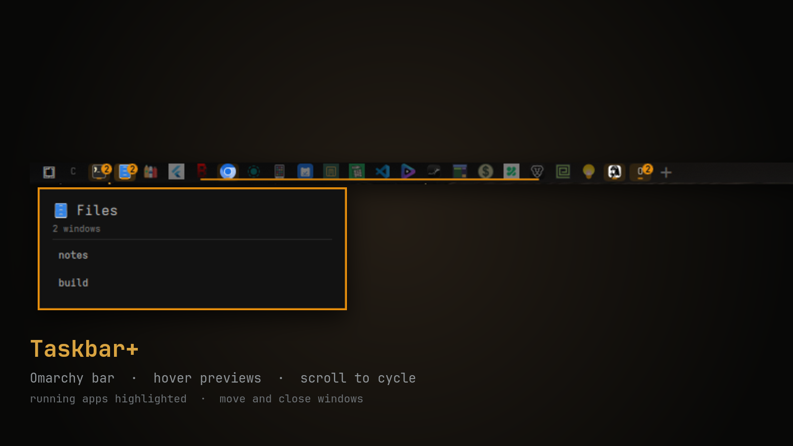

# Taskbar+

Pinned app icons for the [Omarchy](https://omarchy.org/) bar, with window
previews, scroll-to-cycle, running-app highlights, and window actions.

A fork of [Joey Vigil's taskbar](https://github.com/joeyvigil/omarchy-taskbar),
extended and published by [Juan Martin Ruiz](https://github.com/jmr85).



## Install

```bash
omarchy plugin add https://github.com/jmr85/omarchy-taskbar-plus.git --enable --yes
omarchy bar move io.github.jmr85.taskbar --section left
```

Omarchy Quattro (4.x) is required, with the built-in `omarchy.menu` plugin
enabled. The pin and actions pickers are rendered by that menu; without it the
icons still launch and focus, but the editing menus do not open.

Other dependencies:

- `jq`, used by `bin/taskbar-pick` (already a hard dependency of Omarchy).
- Hyprland, for window matching, focusing, moving and closing. The widget
  dispatches through Hyprland's Lua API and falls back to the legacy
  `hyprctl` dispatchers on older configs.
- No network access. The plugin reads local desktop entries, local icon
  directories, and the compositor's window list.

## Why this fork

| Feature | What it does |
|---|---|
| **Window previews** | Hover a running app for a card listing its windows; click a row to focus that window. |
| **Scroll to cycle** | Wheel over an app walks through its windows, wrapping at both ends. |
| **Running highlight** | Running apps get an accent wash behind the icon and an accent rule under it; the focused app is stronger. |
| **Window count badge** | A number appears on the icon when the app has two or more windows. |
| **Window actions** | Right click gains **Move to workspace…** (compositor workspace picker) and **Close window(s)**, with a confirmation. |
| **English / Spanish** | Tooltips, actions and pickers follow the Omarchy language, live, through `i18n/`. |
| **Plain-text hardening** | App names and window titles are flattened before reaching the bar tooltip or the menu picker; every `Text` is `PlainText`. |
| **Shell motion** | Animations go through `Style.duration()`, so `omarchy toggle animations` turns them off. |

## Using it

| Input | What it does |
|---|---|
| **Left click** | Launch the app, or focus it if it is already running |
| **Left click** (already focused) | Cycle to that app's next window |
| **Hover** (running app) | Window list; click a row to focus that window |
| **Wheel** (running app) | Previous/next window of that app |
| **Middle click** | Always launch a new instance |
| **Right click** | New instance, pin/unpin, reorder, move to workspace, close windows |
| **Click the `+`** | Pin an app, from a searchable list of everything installed |

An app that is open but not pinned gets an icon after the pinned ones, and
loses it when its last window closes. Right-click it to keep it for good. Turn
that off with `showRunningApps` if you only want the apps you chose.

Pinning through the `+` also works out how to recognise that app's windows, so
the running indicator works without knowing what a window class is, including
for Omarchy web apps.

## Settings

Settings live inline on the widget's entry in `~/.config/omarchy/shell.json`,
which hot-reloads on save. The bar UI writes to the same place.

| Key | Default | Meaning |
|---|---|---|
| `apps` | `[]` | The pinned entries, in bar order |
| `iconSize` | `17` | Icon edge length in pixels |
| `spacing` | `2` | Gap between icons in pixels |
| `runningIndicator` | `true` | Draw the running/focused rule |
| `highlightRunning` | `true` | Accent wash behind icons of running apps |
| `windowCountBadge` | `true` | Badge with the window count above one |
| `dimWhenClosed` | `true` | Fade icons for apps with no open window |
| `cycleWindows` | `true` | Re-clicking a focused app advances to its next window |
| `wheelCycles` | `true` | Scrolling over an icon cycles its windows |
| `previewOnHover` | `true` | Window list card when hovering a running app |
| `showAddButton` | `true` | Show the trailing `+` for pinning apps |
| `showRunningApps` | `true` | Also show open apps that are not pinned |

With `previewOnHover` on, a running app shows its window card instead of the
bar tooltip; apps with no windows keep the plain tooltip.

Advanced per-app overrides, custom commands and troubleshooting live in
[the configuration notes](docs/configuration.md).

## How pins are stored

Pins are part of this widget's own entry in `shell.json`. Disabling the widget
or removing the plugin removes that entry, and with it the pin list. Copy the
`apps` array out first if you plan to disable and re-enable. The plugin writes
only its own entry, through the host's `updateEntryInline` seam; it never
rewrites the rest of the bar configuration.

## Development

```
manifest.json      plugin declaration and setting schema
BarWidget.qml      the widget the bar mounts
AppModel.js        entry normalization, window matching, list editing
bin/taskbar-pick   shows a list in the Omarchy menu, prints the choice
i18n/              English and Spanish string catalogs
tests/             node tests for the pure helpers
```

Run the tests and validate before opening a change:

```bash
node tests/appmodel.test.js
omarchy plugin validate .
/usr/lib/qt6/bin/qmllint -I "$OMARCHY_PATH/shell" BarWidget.qml
```

Saved files under `~/.config/omarchy/plugins/` reload automatically. Restart
the shell when changing settings wiring or IPC methods:
`omarchy restart shell`.

## Remove

```bash
omarchy plugin remove io.github.jmr85.taskbar
```

This takes the pin list with it, for the same reason as disabling the widget.

## Credits and license

Forked from [joeyvigil/omarchy-taskbar](https://github.com/joeyvigil/omarchy-taskbar)
by [Joey Vigil](https://github.com/joeyvigil), whose original layout, window
matching and picker this plugin still builds on.

MIT License. See [LICENSE](LICENSE): Copyright (c) 2026 Joey Vigil, with
modifications Copyright (c) 2026 Juan Martin Ruiz.
